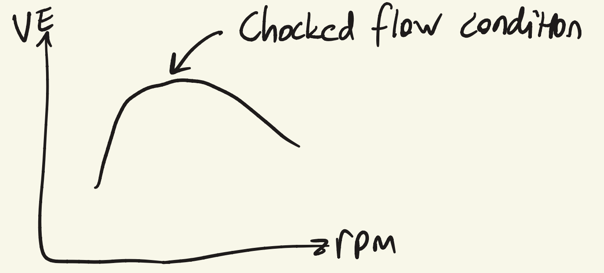
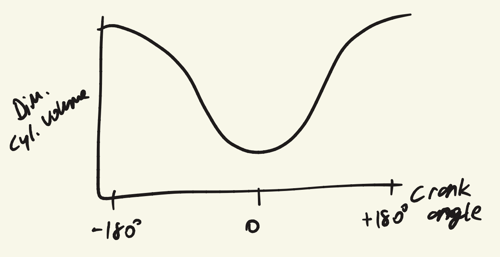
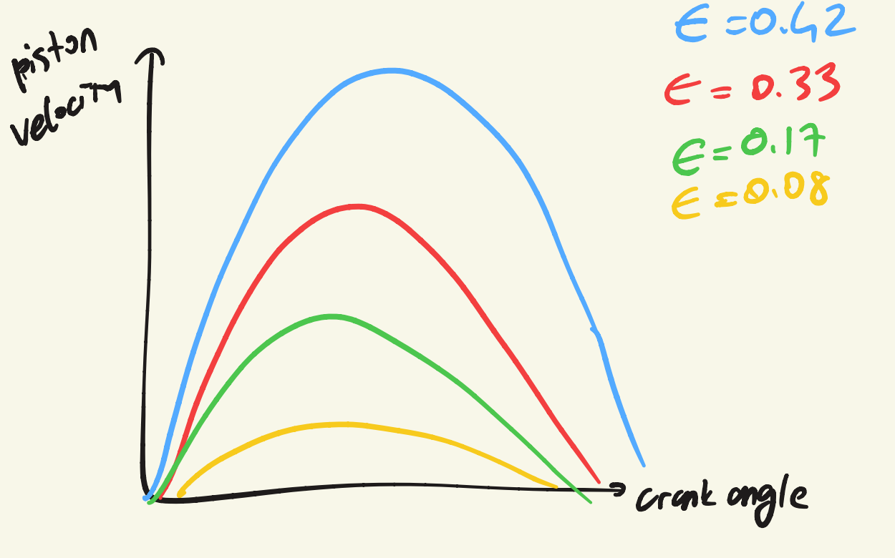

## Requirements for vehicles

- Energy density
- Refueling time
- Required load
- Power

## Power transformation

2nd law of TD: each power transformation process leads to an increase of entropy.

Power types: M = mechanical, E = electrical, C = chemical, H = enthalpy, K = kinetic.

| From power X \ To power Y | M (mechanical) | E (electrical) | C (chemical) | H (enthalpy) | K (kinetic) |
| --- | --- | --- | --- | --- | --- |
| **M** | transmission | electric generator | self charging power cell | pump, compressor | fan, propeller |
| **E** | electric motors | transformer | electrolysis | thermoelectric, magnetocaloric | magneto-hydrodynamic drive |
| **C** | IC engine, gas turbine | fuel cell | chemical reactor | combustion | rocket engine |
| **H** | expansion turbine | thermoelectric | endothermic reaction | ejector-pump | expansion nozzle |
| **K** | flow deflection, Poisson pressure | magneto-hydrodynamic gen. | mechanosynthesis | shear pump | elastic transmissions |

## Engine, transmission, load

Engine $\rightarrow$ Transmission $\rightarrow$ Load

- **Engine:** converter to mechanical power.
- **Transmission:**
  - change mechanical impedance, $F/v$ or $T/\omega$
  - to provide slip
  - bridge distance
- **Load:** human need or economic value.

## Stable operating point

$$
\frac{dT_{e,A}}{d\omega_A} < \frac{dT_{l,A}}{d\omega_A}
$$

- Why torque decreases at high engine speeds: viscous friction effects increase quadratically with engine speed.
- Torque curve is rippled $\rightarrow$ airflow dynamics and mechanical friction.

## Mean effective pressure

$$
\text{mep} = \frac{W}{V_d}
$$

$W$: average work in a stroke. $V_d$: volume displaced by piston.

**Indicated mean effective pressure:**

$$
\text{imep} = \frac{W_i}{V_d}
$$

**Brake MEP:**

$$
\text{bmep} = \frac{W_b}{V_d}
$$

**Friction MEP:**

$$
\text{fmep} = \text{imep} - \text{bmep}
$$

## Volumetric efficiency

$$
e_v = \frac{V_{in}}{V_d}
$$

The ratio of the actual max volume of fuel mixture in the cylinder and the hypothetical volume which can be occupied.

Why $e_v < 1$:

- Pressure drop through the valve
- High speed piston
- Valve size, lift off time

These set the air mass per cycle, which sets the power ceiling. $e_v$ is a measure of how well an engine is breathing.

$$
e_v = \frac{\dot{m}_{in}}{\rho_i V_d N/2}
\qquad
\dot{m}_{in} = \dot{m}_a + \dot{m}_f \ \text{(air + fuel)}
$$

## Specific fuel consumption

$$
\text{SFC} = \frac{\dot{m}_f}{\dot{W}}
$$

- Brake SFC (output shaft): $\text{bsfc} = \dfrac{\dot{m}_f}{\dot{W}_b}$
- Indicated SFC (inside the piston): $\text{isfc} = \dfrac{\dot{m}_f}{\dot{W}_i}$

$$
\text{bsfc} > \text{isfc}
$$

## Brake thermal efficiency

$$
\eta = \frac{\dot{W}_b}{\dot{m}_f q_c} = \frac{1}{\text{bsfc} \cdot q_c}
$$

$q_c$: heat of combustion $[\text{kJ/kg}]$.

## Exercise

Single cylinder, 380 cc, two stroke, 5500 rpm, bore $= 82$ mm, stroke $72$ mm, bmep $= 6.81$ bar, bsfc $= 0.49$ kg/kW hr, delivery ratio $= 0.748$. Fuel/air ratio?

$$
FA = \frac{\dot{m}_f}{\dot{m}_a}
\qquad
D_r = \frac{\dot{m}_a}{\rho_{amb} \cdot V_d \cdot N}
$$

$$
\dot{m}_a = 1 \cdot (380\text{e-}6) \cdot 91.6 \ \text{rev/s} \cdot D_r \quad \rightarrow \quad 0.0398
$$

Displacement volume:

$$
\pi r^2 S = \frac{B^2 \pi S}{4} = 380\text{e}3 \ \text{mm}^3 = 380\text{e-}6 \ \text{m}^3
\qquad
V_d = 0.38\text{e-}3 \ \text{m}^3
$$

Torque and work per cycle:

$$
\text{bmep} = \frac{W_b}{V_d} = 6.81 \ \text{bar}
\qquad
W_b = 2\pi \cdot 1 \cdot T = 2\pi T
$$

$$
\frac{2\pi T}{380\text{e-}6} = 6.81 \times 10^5 \ \text{Pa}
\quad \Rightarrow \quad
T = 41.18 \ \text{N.m}
\qquad
W_b = 258 \ \text{J}
$$

Power:

$$
\dot{W}_b = W \cdot \frac{N}{n_r} \quad (N = 91.6 \ \text{rev/s}, \ n_r = 1)
\quad \Rightarrow \quad
\dot{W}_b = 23 \ \text{kW}
$$

Fuel flow:

$$
0.49 \ \frac{\text{kg}}{\text{kW.hr}} \cdot \frac{1 \ \text{hr}}{3600 \ \text{s}} \cdot \frac{1 \ \text{kW}}{1000 \ \text{W}}
\quad \Rightarrow \quad
\dot{m}_f = 3.13\text{e-}3 \ \text{kg/s}
$$

(Several intermediate values on the page are crossed out and corrected: $4.118\text{e-}4$ N.m became $41.18$, $2.58\text{e-}3$ became $258$, $0.23$ W became $23$ kW, and $\dot{m}_f = 3.13\text{e-}8$ became $3.13\text{e-}3$ kg/s. The final fuel/air ratio is scribbled over and I couldn't read it reliably.)

## Compression ratio and crank kinematics

$$
r = \frac{V_{bdc}}{V_{tdc}} = \frac{V_1}{V_c}
$$

$\tilde{V}(\theta)$ with $\epsilon \rightarrow 0$:

$$
\tilde{V}(\theta) \cong 1 - \frac{r - 1}{2}\left(1 - \cos\theta\right)
$$

$$
\epsilon = \frac{a}{\ell}
\qquad
a: \text{crankshaft length}, \quad \ell: \text{connecting rod length}
\qquad
\theta = \omega t
$$

