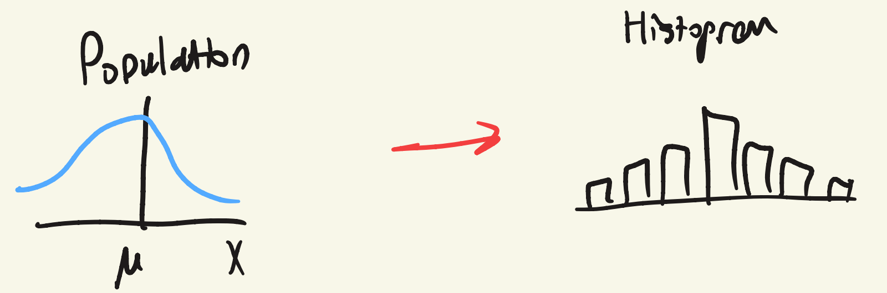

## Population and sample

- $\mu$: population average
- $\sigma$: population std. dev.
- $\bar{X}$: sample average
- $s$: sample std. dev.

**Point estimate:** $\bar{x} = 45.5$ MPa is a point estimate for $\mu$.

**Hypothesis testing:** evidence of $\mu = 45.5$ MPa.

**Interval estimate:** $43.5 \leq \mu \leq 47.5$ MPa, for a given degree of confidence.

## Point estimates

Unknown parameter $\theta$, statistic $\hat{\Theta}$, point estimate $\hat{\theta}$.

| Unknown parameter | Point estimate |
| --- | --- |
| $\mu$ | $\bar{x}$ |
| $\sigma^2$ | $s^2$ |
| $p$ | $\hat{p}$ |
| $\mu_1 - \mu_2$ | $\bar{x}_1 - \bar{x}_2$ |

## Properties of estimators

**Bias:**

$$
\operatorname{Bias}(\hat{\Theta}, \theta) = E(\hat{\Theta}) - \theta
$$

Unbiased: $\operatorname{Bias}(\hat{\Theta}, \theta) = 0$

**Mean square error:**

$$
\operatorname{MSE}(\hat{\Theta}) = E\left(\hat{\Theta} - \theta\right)^2 = V(\hat{\Theta}) + \operatorname{Bias}(\hat{\Theta}, \theta)^2
$$

## Hypothetical testing

- Moves from describing the data to "making statements".
- A hypothesis implies always an alternative hypothesis.

Example:

$$
\bar{x} = 319.5 \ \text{MPa} \qquad S = 9.0 \ \text{MPa}
$$

- $H_0: \mu = 320$ MPa, null hypothesis
- $H_1: \mu \neq 320$ MPa, alternative hypothesis

## Procedure

1. Identify the parameter of interest.
2. State the null hypothesis.
3. State the alternative hypothesis.
4. State a test statistic.
5. Define the criteria that will lead to the rejection of $H_0$.
6. Computations.
7. Conclusion: decide whether or not $H_0$ should be rejected or not.

## Decisions in hypothesis testing

| Decision | $H_0$ is true | $H_0$ is false |
| --- | --- | --- |
| Fail to reject $H_0$ | No error | Type II error |
| Reject $H_0$ | Type I error | No error |

$$
\alpha = P(\text{type I error}) = P(\text{reject } H_0 \text{ when } H_0 \text{ is true})
$$

$$
\beta = P(\text{type II error}) = P(\text{fail to reject } H_0 \text{ when } H_0 \text{ is false})
$$

Type I error probability $\rightarrow$ significance level, $\alpha$-error, **size** of the test.

## Court analogy

- $H_0$: defendant is innocent
- $H_1$: defendant is guilty

Court's decision, against the true situation:

| True situation | Not guilty | Guilty |
| --- | --- | --- |
| Not guilty ($H_0$ true) | $1 - \alpha$, true negative | $\alpha$, Type I error, false positive |
| Guilty ($H_1$ true) | $\beta$, Type II error, false negative | $1 - \beta$, power, true positive |

- Reduce $\alpha$! $\rightarrow$ innocent until proven guilty.
- The bigger the sample, the less $\beta$ there is.

## P-value

P-value is the smallest level of significance that would lead to a rejection of the null hypothesis $H_0$.
