*Notation: underlined symbols are vectors ($\underline{a}$), double-underlined symbols are second-order tensors ($\underline{\underline{\sigma}}$).*

## Traction vector

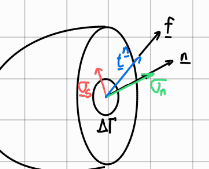

$$
\underline{t}^{n} = \lim_{\Delta\Gamma \to 0} \frac{\underline{f}}{\Delta\Gamma} \qquad \rightarrow \text{traction vector}
$$

$$
\sigma_n = \underline{t}^{n} \cdot \underline{n}
$$

$$
\underline{\sigma}_s = \underline{t}^{n} - \sigma_n \underline{n}
$$

## Example: thin-walled hollow rod, glued interface ($t \ll R$)

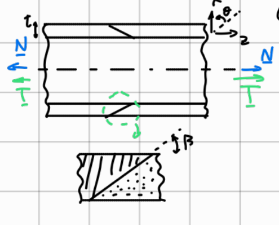

Find $\underline{t}^{n}$ on the glued surface, and $\sigma_n$, $\underline{\sigma}_s$. We need to use the $r, \theta, z$ coordinate frame.

$$
\underline{t}^{n} = \underline{t}^{n}(N) + \underline{t}^{n}(T)
$$

$$
\Delta\Gamma = \frac{\pi (2R + t)^2 - \pi (2R - t)^2}{4 \sin\beta} \simeq \frac{2\pi R t}{\sin\beta}
$$

> Margin note (Turkish, blue): "şurda t≪R olduğundan 2πR × t / sinβ kabul olan dedik" — roughly: since $t \ll R$ here, the area is taken as $2\pi R t / \sin\beta$. (Last words hard to read.)

$$
\underline{t}^{n}(N) = \begin{Bmatrix} 0 \\ 0 \\ \frac{N \sin\beta}{2\pi R t} \end{Bmatrix}
\qquad
\underline{t}^{n}(T) = \begin{Bmatrix} 0 \\ \frac{T \sin\beta}{2\pi R^2 t} \\ 0 \end{Bmatrix}
\quad \text{(divide by } R \text{, lever)}
$$

$$
\Rightarrow \underline{t}^{n} = \begin{Bmatrix} 0 \\ \frac{T \sin\beta}{2\pi R^2 t} \\ \frac{N \sin\beta}{2\pi R t} \end{Bmatrix}
$$

$$
\underline{n} = \begin{Bmatrix} \cos\beta \\ 0 \\ \sin\beta \end{Bmatrix}
$$

$$
\sigma_n = \underline{t}^{n} \cdot \underline{n}
= \begin{Bmatrix} 0 \\ \frac{T \sin\beta}{2\pi R^2 t} \\ \frac{N \sin\beta}{2\pi R t} \end{Bmatrix} \cdot \begin{Bmatrix} \cos\beta \\ 0 \\ \sin\beta \end{Bmatrix}
= \frac{N \sin^2\beta}{2\pi R t}
$$

$$
\underline{\sigma}_s = \underline{t}^{n} - \sigma_n \underline{n}
= \begin{Bmatrix} 0 \\ \frac{T \sin\beta}{2\pi R^2 t} \\ \frac{N \sin\beta}{2\pi R t} \end{Bmatrix}
- \begin{Bmatrix} \frac{N \sin^2\beta \cos\beta}{2\pi R t} \\ 0 \\ \frac{N \sin^3\beta}{2\pi R t} \end{Bmatrix}
= \begin{Bmatrix} -\frac{N \sin^2\beta \cos\beta}{2\pi R t} \\ \frac{T \sin\beta}{2\pi R^2 t} \\ \frac{N \sin\beta \cos^2\beta}{2\pi R t} \end{Bmatrix}
$$

$$
\sigma_s = \|\underline{\sigma}_s\| = \sqrt{\left(-\frac{N \sin^2\beta \cos\beta}{2\pi R t}\right)^2 + \left(\frac{T \sin\beta}{2\pi R^2 t}\right)^2 + \left(\frac{N \sin\beta \cos^2\beta}{2\pi R t}\right)^2}
$$

## Stress tensor

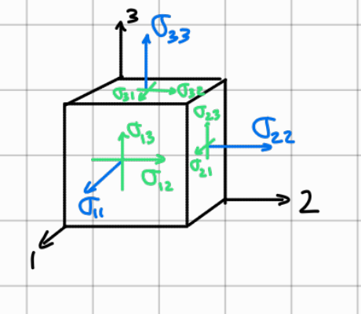

$$
\underline{\underline{\sigma}} = \begin{pmatrix} \sigma_{11} & \sigma_{12} & \sigma_{13} \\ \sigma_{21} & \sigma_{22} & \sigma_{23} \\ \sigma_{31} & \sigma_{32} & \sigma_{33} \end{pmatrix}
\qquad
\underline{t}^{n} = \underline{\underline{\sigma}} \cdot \underline{n}
\qquad
\sigma_{ij} = t_j^{e_i}
$$

- Symmetry: $\sigma_{ij} = \sigma_{ji}$
- $\sigma_{11}, \sigma_{22}, \sigma_{33}$ are normal stresses
- $+$ = tension, $-$ = compression
- Sign convention

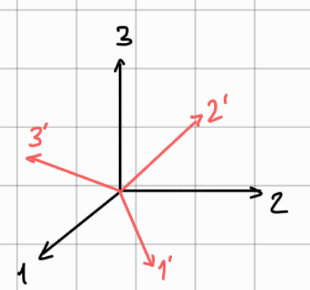

**NEVER FORGET!!!**

$$
\underline{u}' = [A]\, \underline{u}
\qquad
\underline{\underline{\sigma}}' = [A]\, \underline{\underline{\sigma}}\, [A]^T
$$

## Example: stress tensor of the thin-walled rod in $r, \theta, z$

Establish $\underline{\underline{\sigma}}$ in $r, \theta, z$, then find $\underline{t}^{n}$.

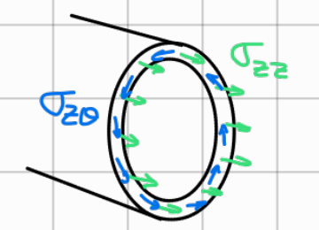

$$
\underline{\underline{\sigma}} = \begin{pmatrix} 0 & 0 & 0 \\ 0 & 0 & \frac{T}{2\pi R^2 t} \\ 0 & \frac{T}{2\pi R^2 t} & \frac{N}{2\pi R t} \end{pmatrix}
$$

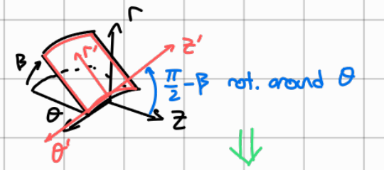

Rotation of $\frac{\pi}{2} - \beta$ around $\theta$:

$$
[A] = \begin{pmatrix} \sin\beta & 0 & -\cos\beta \\ 0 & 1 & 0 \\ \cos\beta & 0 & \sin\beta \end{pmatrix}
$$

$$
\underline{t}^{n} = \underline{\underline{\sigma}} \cdot \underline{n}
= \begin{pmatrix} 0 & 0 & 0 \\ 0 & 0 & \frac{T}{2\pi R^2 t} \\ 0 & \frac{T}{2\pi R^2 t} & \frac{N}{2\pi R t} \end{pmatrix} \cdot \begin{Bmatrix} \cos\beta \\ 0 \\ \sin\beta \end{Bmatrix}
= \begin{Bmatrix} 0 \\ \frac{T \sin\beta}{2\pi R^2 t} \\ \frac{N \sin\beta}{2\pi R t} \end{Bmatrix}
\quad \text{(same as before)}
$$

## Example: hollow rod, thin-walled ($R = 30$ mm, $t = 1$ mm)

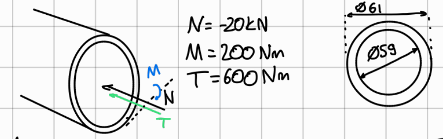

$N = -20$ kN, $M = 200$ Nm, $T = 600$ Nm; outer diameter $\varnothing 61$, inner diameter $\varnothing 59$.

At the position with maximum compressive stress: find $\underline{\underline{\sigma}}$ and mark the stress components in a 3D sketch.

$$
A = 188.5 \ \text{mm}^2 \quad \rightarrow \quad \sigma_{zz} = \frac{N}{A} = \frac{-20 \ \text{kN}}{188.5 \ \text{mm}^2} = -106 \ \text{MPa}
$$

$$
I = \frac{\pi D^4}{64} = 84.9 \times 10^3 \ \text{mm}^4 \quad \rightarrow \quad \sigma_{zz} = \pm 72 \ \text{MPa} \quad \left(\sigma = \frac{M y}{I}\right)
$$

$$
J = 169.7 \times 10^3 \ \text{mm}^4 \quad \rightarrow \quad \sigma_{z\theta} = 108 \ \text{MPa}, \quad \sigma_{\theta z} = 108 \ \text{MPa} \quad \left(\sigma_s = \frac{T r}{J}\right)
$$

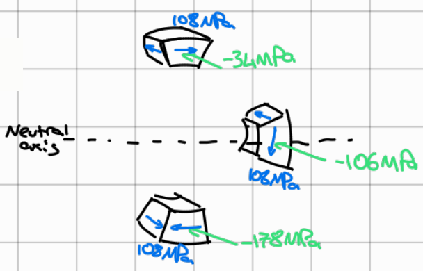

Element values from the sketch: top $108$ MPa shear and $-34$ MPa; on the neutral axis $108$ MPa shear and $-106$ MPa; bottom $108$ MPa shear and $-178$ MPa (the point of maximum compression).

## Example: thin-walled pressure vessel closed with end lids

$p = 10$ bar, $R = 60$ mm, $t = 1$ mm (diameters $\varnothing 118$ inner, $\varnothing 122$ outer).

Find $\underline{\underline{\sigma}}$ in $r, \theta, z$ and $\underline{\underline{\sigma}}'$ in $1, 2, 3$ (axis 3 makes $30^\circ$ with $z$).

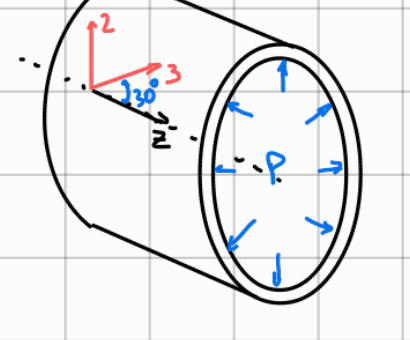

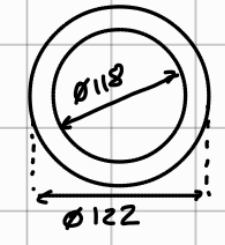

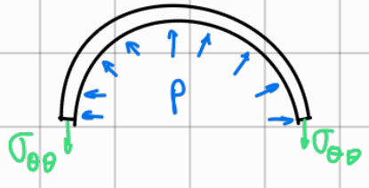

Hoop stress:

$$
p \, 2R = \sigma_{\theta\theta} \cdot t \cdot 2 \quad \Rightarrow \quad \sigma_{\theta\theta} = p \frac{R}{t} = 60 \ \text{MPa}
$$

Lid:

$$
p \pi R^2 = \sigma_{zz} \, 2\pi R t \quad \Rightarrow \quad \sigma_{zz} = p \frac{R}{2t} = 30 \ \text{MPa}
$$

$$
\Rightarrow \underline{\underline{\sigma}} = \begin{pmatrix} 0 & 0 & 0 \\ 0 & 60 & 0 \\ 0 & 0 & 30 \end{pmatrix} \ [\text{MPa}]
$$

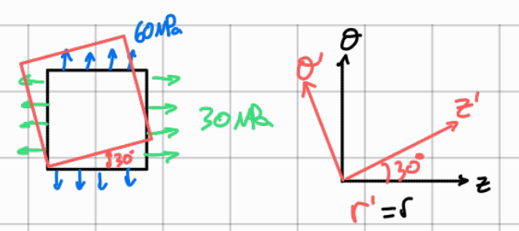

$$
\Rightarrow [A] = \begin{pmatrix} 1 & 0 & 0 \\ 0 & \cos 30^\circ & -\sin 30^\circ \\ 0 & \sin 30^\circ & \cos 30^\circ \end{pmatrix}
$$

$$
\Rightarrow \underline{\underline{\sigma}}' = [A]\, \underline{\underline{\sigma}}\, [A]^T = \begin{pmatrix} 0 & 0 & 0 \\ 0 & 52.3 & 13 \\ 0 & 13 & 37.5 \end{pmatrix} \ [\text{MPa}]
$$
