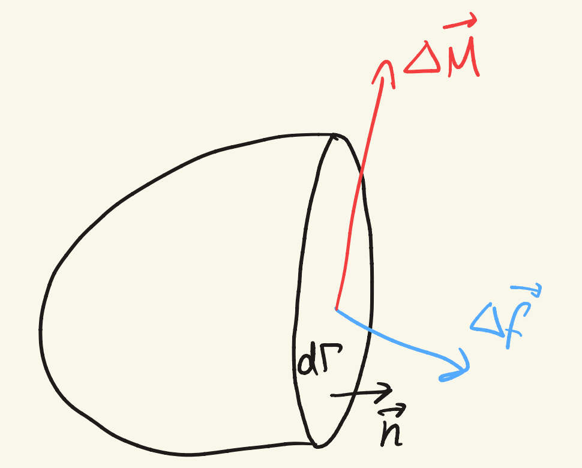
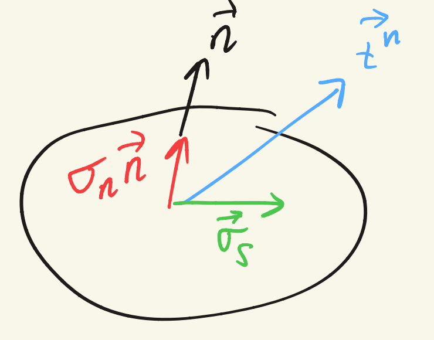

## Chapter 2: Stresses

- Body $\Omega$
- Boundary $\Gamma = \partial\Omega$
- Mass density $\rho$ $[\text{kg/m}^3]$
- Acceleration: $\vec{b}$ $[\text{m/s}^2]$
- Body load: $\rho\vec{b}$ $[\text{N/m}^3]$
- Surface load $\vec{t}^{\,n}$ $[\text{N/m}^2]$ on a face with outward normal $\vec{n}$, including discrete forces $\vec{F}$ $[\text{N}]$

## Traction on a cut surface

$$
\vec{t}^{\,n} = \frac{\Delta\vec{f}}{\Delta\Gamma}
$$

$$
\lim_{\Delta\Gamma \to 0} \frac{\Delta\vec{f}}{\Delta\Gamma} = \vec{t}^{\,n}
\qquad
\lim_{\Delta\Gamma \to 0} \frac{\Delta\vec{M}}{\Delta\Gamma} = 0
$$

The moment term vanishes because the lever arm goes to zero.

## Normal and shear components

$$
\sigma_n = \vec{t}^{\,n} \cdot \vec{n} = t_i^{\,n} n_i
$$

$$
\vec{\sigma}_s = \vec{t}^{\,n} - \vec{\sigma}_n = \vec{t}^{\,n} - \sigma_n \vec{n}
$$

$$
\sigma_s = \|\vec{\sigma}_s\| = \sqrt{\|\vec{t}^{\,n}\|^2 - \|\sigma_n\|^2}
$$

$$
\vec{t}^{\,n} = \vec{\sigma} \cdot \vec{n}
$$

- Positive $\rightarrow$ tension
- Negative $\rightarrow$ compression

## Principal stresses

Properties of an eigenvalue problem:

$$
\begin{pmatrix} \sigma_{11} - \sigma_n & \sigma_{12} & \sigma_{13} \\ \sigma_{21} & \sigma_{22} - \sigma_n & \sigma_{23} \\ \sigma_{31} & \sigma_{32} & \sigma_{33} - \sigma_n \end{pmatrix}
\begin{Bmatrix} n_1 \\ n_2 \\ n_3 \end{Bmatrix}
= \begin{Bmatrix} 0 \\ 0 \\ 0 \end{Bmatrix}
$$

- The three principal directions $\vec{n}^{(i)}$ are orthogonal if the eigenvalues are different.
- If all three eigenvalues $\sigma_i$ are different, two out of three equations in the system are independent and the eigenvectors are uniquely defined.
- If two eigenvalues are identical, only the eigenvector that corresponds to the third eigenvalue has a unique orientation in space.
- If all three eigenvalues are identical, any vector in 3D space is an eigenvector $\rightarrow$ hydrostatic stress.

Invariants:

$$
I_{1\sigma} = \sigma_1 + \sigma_2 + \sigma_3 = \operatorname{tr}(\sigma)
$$

$$
I_{2\sigma} = \sigma_1\sigma_2 + \sigma_2\sigma_3 + \sigma_3\sigma_1 = \frac{1}{2}\left[(\operatorname{tr}\sigma)^2 - \operatorname{tr}(\sigma^2)\right]
$$

$$
I_{3\sigma} = \sigma_1 \cdot \sigma_2 \cdot \sigma_3 = \det(\sigma)
$$

## Plane stress

Plane stress applies to thin structures, or to a free surface on thick structures.

$$
\sigma = \begin{bmatrix} \sigma_{11} & \sigma_{12} & 0 \\ \sigma_{21} & \sigma_{22} & 0 \\ 0 & 0 & 0 \end{bmatrix}
\quad \rightarrow \quad
\sigma = \begin{bmatrix} \sigma_{11} & \sigma_{12} \\ \sigma_{21} & \sigma_{22} \end{bmatrix}
$$

$$
A = \begin{bmatrix} \cos\theta & \sin\theta & 0 \\ -\sin\theta & \cos\theta & 0 \\ 0 & 0 & 1 \end{bmatrix}
\quad \rightarrow \quad
A = \begin{bmatrix} \cos\theta & \sin\theta \\ -\sin\theta & \cos\theta \end{bmatrix}
$$

Invariants do not get affected by coordinate transformations.
