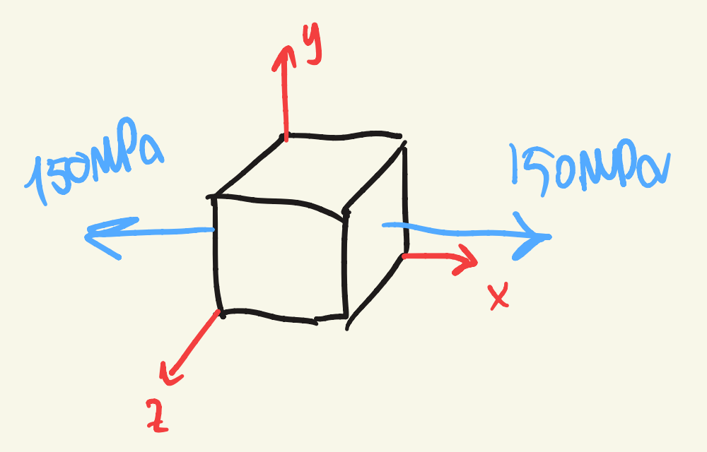
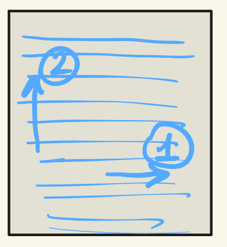
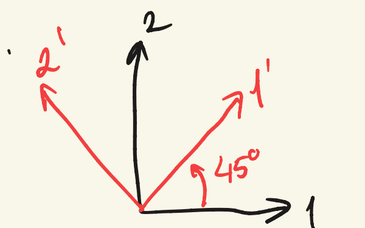
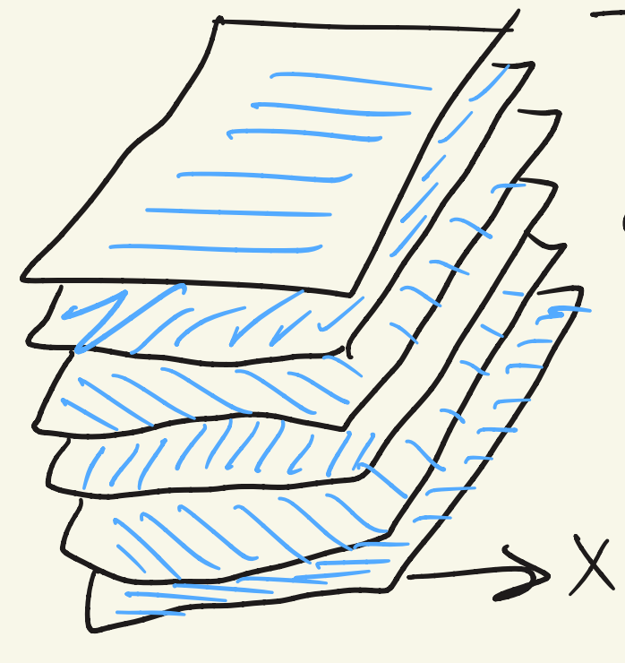

## Example: Al 2024-T3 under uniaxial load

$E = 73.1$ GPa, $\nu = 0.33$

Find $[D]$ and $[C]$, $\lambda$, $\mu$, and all strain components for:

- (a) $\sigma_{yy} = 0$, $\sigma_{zz} = 0$
- (b) $\sigma_{yy} = 0$, $\epsilon_{zz} = 0$
- (c) $\epsilon_{yy} = 0$, $\epsilon_{zz} = 0$

$$
[D] = \begin{pmatrix}
13.7 & -4.51 & -4.51 & & & \\
-4.51 & 13.7 & -4.51 & & & \\
-4.51 & -4.51 & 13.7 & & & \\
& & & 18.2 & & \\
& & & & 18.2 & \\
& & & & & 18.2
\end{pmatrix} \times 10^{-12} \ \text{Pa}^{-1}
$$

$$
[C] = \begin{pmatrix}
108.3 & 53.3 & 53.3 & & & \\
53.3 & 108.3 & 53.3 & & & \\
53.3 & 53.3 & 108.3 & & & \\
& & & 55 & & \\
& & & & 55 & \\
& & & & & 55
\end{pmatrix} \ \text{GPa}
$$

**Case a)**

$$
\begin{Bmatrix} \epsilon_{xx} \\ \epsilon_{yy} \\ \epsilon_{zz} \end{Bmatrix} = \begin{Bmatrix} 2055 \\ -678 \\ -678 \end{Bmatrix} \cdot 10^{-6}
$$

**Case b)**

$$
\begin{Bmatrix} \epsilon_{xx} \\ \epsilon_{yy} \\ \epsilon_{zz} \end{Bmatrix} = \begin{Bmatrix} 1833 \\ -900 \\ 0 \end{Bmatrix} \cdot 10^{-6}
\qquad \rightarrow \sigma_{zz} = 49.5 \ \text{MPa}
$$

**Case c)**

$$
\begin{Bmatrix} \epsilon_{xx} \\ \epsilon_{yy} \\ \epsilon_{zz} \end{Bmatrix} = \begin{Bmatrix} 1388 \\ 0 \\ 0 \end{Bmatrix} \cdot 10^{-6}
\qquad \rightarrow \sigma_{yy} = \sigma_{zz} = 73.9 \ \text{MPa}
$$

## Orthotropic materials

$$
\begin{Bmatrix} \epsilon_{xx} \\ \epsilon_{yy} \\ \epsilon_{zz} \\ \epsilon_{xy} \\ \epsilon_{yz} \\ \epsilon_{zx} \end{Bmatrix}
= \begin{pmatrix}
\frac{1}{E} & -\frac{\nu_{yx}}{E_y} & -\frac{\nu_{zx}}{E_z} & & & \\
-\frac{\nu_{xy}}{E_x} & \frac{1}{E_y} & -\frac{\nu_{zy}}{E_z} & & & \\
-\frac{\nu_{xz}}{E_x} & -\frac{\nu_{yz}}{E_y} & \frac{1}{E_z} & & & \\
& & & \frac{1}{2G_{xy}} & & \\
& & & & \frac{1}{2G_{yz}} & \\
& & & & & \frac{1}{2G_{zx}}
\end{pmatrix}
\begin{Bmatrix} \sigma_{xx} \\ \sigma_{yy} \\ \sigma_{zz} \\ \sigma_{xy} \\ \sigma_{yz} \\ \sigma_{zx} \end{Bmatrix}
$$

The off-diagonal terms are circled in pairs on the page: each pair is equal by symmetry of the matrix. 9 coefficients in 3D.

## Example: one orthotropic layer

- $E_1 = 127$ GPa
- $E_2 = 10$ GPa
- $G_{12} = 5.44$ GPa
- $\nu_{12} = 0.34$
- one layer $t = 0.26$ mm
- load: $\sigma_{xx} = 100$ MPa, $\sigma_{yy} = \sigma_{xy} = 0$

Find $[D]$ and $[C]$ in the 1,2 reference frame, and $\langle\epsilon\rangle$:

- when $x$ is aligned with 1
- when $x$ is aligned with 2
- when $x$ is at $45^\circ$ w.r.t. 1

$$
\frac{-\nu_{12}}{E_1} = \frac{-\nu_{21}}{E_2}
\quad \Rightarrow \quad
\frac{-0.34}{127 \ \text{GPa}} = \frac{-\nu_{21}}{10 \ \text{GPa}}
\quad \Rightarrow \quad
\nu_{21} = 0.027
$$

$$
[D] = \begin{bmatrix}
\frac{1}{E_1} & -\frac{\nu_{21}}{E_2} & 0 \\
-\frac{\nu_{21}}{E_1} & \frac{1}{E_2} & 0 \\
0 & 0 & \frac{1}{2G_{12}}
\end{bmatrix}
= \begin{bmatrix}
7.87 & -2.7 & 0 \\
-2.68 & 100 & 0 \\
0 & 0 & 91.9
\end{bmatrix} \times 10^{-12} \ \text{Pa}^{-1}
$$

$$
[C] = \begin{pmatrix}
128.2 & 3.43 & 0 \\
3.43 & 10.1 & 0 \\
0 & 0 & 10.9
\end{pmatrix}
$$

(Units are not written on the page for $[C]$.)

## Plane stress and plane strain

$$
\text{Plane stress:} \quad \sigma_{zz} = \sigma_{zy} = \sigma_{zx} = 0
$$

$$
\text{Plane strain:} \quad \epsilon_{zz} = \epsilon_{zy} = \epsilon_{zx} = 0
$$

These are different things in non-isotropic materials.

**a) $x$ aligned with 1**

$$
\begin{Bmatrix} \epsilon_{xx} \\ \epsilon_{yy} \\ \epsilon_{xy} \end{Bmatrix} = \begin{Bmatrix} 787 \\ -268 \\ 0 \end{Bmatrix} \cdot 10^{-6}
$$

**b) $x$ aligned with 2**

$$
\begin{Bmatrix} \epsilon_{xx} \\ \epsilon_{yy} \\ \epsilon_{xy} \end{Bmatrix} = \begin{Bmatrix} 10000 \\ -268 \\ \ \end{Bmatrix} \cdot 10^{-6}
$$

(The third entry is left blank on the page.)

## c) $x$ at $45^\circ$ with respect to 1

$$
A = \begin{pmatrix} a_{11} & a_{12} \\ a_{21} & a_{21} \end{pmatrix}
= \begin{pmatrix} \cos\theta & \sin\theta \\ -\sin\theta & \cos\theta \end{pmatrix}
$$

$$
\underline{\underline{\sigma}}' = [A]\, \underline{\underline{\sigma}}\, [A]^T
$$

$$
\langle\sigma\rangle' = [T_\sigma]\langle\sigma\rangle
\qquad
\langle\epsilon\rangle' = [T_\epsilon]\langle\epsilon\rangle
$$

$$
[T_\sigma] = \begin{pmatrix}
a_{11}^2 & a_{12}^2 & 2a_{11}a_{12} \\
a_{21}^2 & a_{22}^2 & 2a_{21}a_{22} \\
a_{11}a_{21} & a_{12}a_{22} & a_{11}a_{22} + a_{12}a_{21}
\end{pmatrix}
\qquad
[T_\sigma]^{-1} = \begin{pmatrix}
a_{11}^2 & a_{21}^2 & 2a_{11}a_{21} \\
a_{12}^2 & a_{22}^2 & 2a_{12}a_{22} \\
a_{11}a_{12} & a_{21}a_{22} & a_{11}a_{22} + a_{21}a_{12}
\end{pmatrix}
$$

$$
[T_\epsilon] = \begin{pmatrix}
a_{11}^2 & a_{12}^2 & a_{11}a_{12} \\
a_{21}^2 & a_{22}^2 & a_{21}a_{22} \\
2a_{11}a_{21} & 2a_{12}a_{22} & a_{11}a_{22} + a_{12}a_{21}
\end{pmatrix}
\qquad
[T_\epsilon]^{-1} = \begin{pmatrix}
a_{11}^2 & a_{21}^2 & a_{11}a_{21} \\
a_{12}^2 & a_{22}^2 & a_{12}a_{22} \\
2a_{11}a_{12} & 2a_{21}a_{22} & a_{11}a_{22} + a_{21}a_{12}
\end{pmatrix}
$$

**IMPORTANT!**

$$
[C]' = [T_\sigma]\,[C]\,[T_\epsilon]^{-1}
\qquad
[D]' = [T_\epsilon]\,[D]\,[T_\sigma]^{-1}
$$

For $45^\circ$:

$$
[T_\sigma] = \begin{pmatrix} 0.5 & 0.5 & 1 \\ 0.5 & 0.5 & -1 \\ -0.5 & 0.5 & 0 \end{pmatrix}
\qquad
[T_\sigma]^{-1} = \begin{pmatrix} 0.5 & 0.5 & -1 \\ 0.5 & 0.5 & 1 \\ 0.5 & -0.5 & 0 \end{pmatrix}
$$

$$
[T_\epsilon] = \begin{pmatrix} 0.5 & 0.5 & 0.5 \\ 0.5 & 0.5 & -0.5 \\ -1 & 1 & 0 \end{pmatrix}
\qquad
[T_\epsilon]^{-1} = \begin{pmatrix} 0.5 & 0.5 & -0.5 \\ 0.5 & 0.5 & 0.5 \\ 1 & -1 & 0 \end{pmatrix}
$$

Rotation over $45^\circ$:

$$
[C_{45^\circ}] = \begin{pmatrix}
47.2 & 25.4 & -29.5 \\
25.4 & 47.2 & -29.5 \\
-29.2 & -29.5 & 32.9
\end{pmatrix} \ \text{GPa}
$$

$$
[D_{45^\circ}] = \begin{pmatrix}
48.7 & 2.65 & 46.1 \\
2.65 & 48.7 & 46.1 \\
46.1 & 46.1 & 113.3
\end{pmatrix} \times 10^{-12} \ \text{Pa}^{-1}
$$

$$
\begin{Bmatrix} \epsilon_{xx} \\ \epsilon_{yy} \\ \gamma_{xy} \end{Bmatrix} = \begin{Bmatrix} 4870 \\ 265 \\ 4610 \end{Bmatrix} \cdot 10^{-6}
$$

## Layered composite

7 layers: $0^\circ / 45^\circ / -45^\circ / 90^\circ / -45^\circ / +45^\circ / 0^\circ$

$\sigma_{xx} = 100$ MPa, $\sigma_{yy} = \sigma_{xy} = 0$

$\langle\epsilon\rangle$ and $\langle\sigma\rangle$ per layer?

Procedure:

1. Add $[C^{(i)}]$ per layer $\rightarrow$ sum of 7.
2. Calculate $\langle\epsilon\rangle$.
3. Layer by layer, calculate $\langle\sigma\rangle$ from $\langle\epsilon\rangle$ by multiplication with $[C^{(i)}]$.

$$
\begin{Bmatrix} \sigma_{xx} \cdot 1.82 \ \text{mm} \\ \sigma_{yy} \cdot 1.82 \ \text{mm} \\ \sigma_{xy} \cdot 1.82 \ \text{mm} \end{Bmatrix}
= \begin{pmatrix} 118.4 & 29.1 & 0 \\ 29.1 & 87.7 & 0 \\ 0 & 0 & 42.7 \end{pmatrix} \text{MN/m} \cdot
\begin{Bmatrix} \epsilon_{xx} \\ \epsilon_{yy} \\ \gamma_{xy} \end{Bmatrix}
$$

$$
\epsilon_{xy} = 167 \cdot 10^{-6}
\qquad
\epsilon_{yy} = -555 \cdot 10^{-6}
$$

Stresses per layer:

$$
\begin{Bmatrix} \sigma_{xx} \\ \sigma_{yy} \\ \sigma_{xy} \end{Bmatrix}
= \begin{Bmatrix} 213 \\ -0.1 \\ 0 \end{Bmatrix} \text{MPa} \ (\text{plates 1 and 7}),
\quad
\begin{Bmatrix} 64.9 \\ 16.3 \\ -33 \end{Bmatrix} \text{MPa} \ (\text{plates 2 and 6})
$$

$$
\begin{Bmatrix} 64.9 \\ 16.3 \\ 33 \end{Bmatrix} \text{MPa} \ (\text{plates 3 and 5}),
\quad
\begin{Bmatrix} 15 \\ -65.4 \\ 0 \end{Bmatrix} \text{MPa} \ (\text{plate 4})
$$
