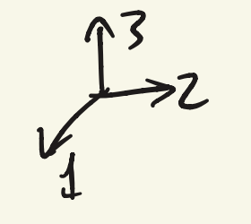
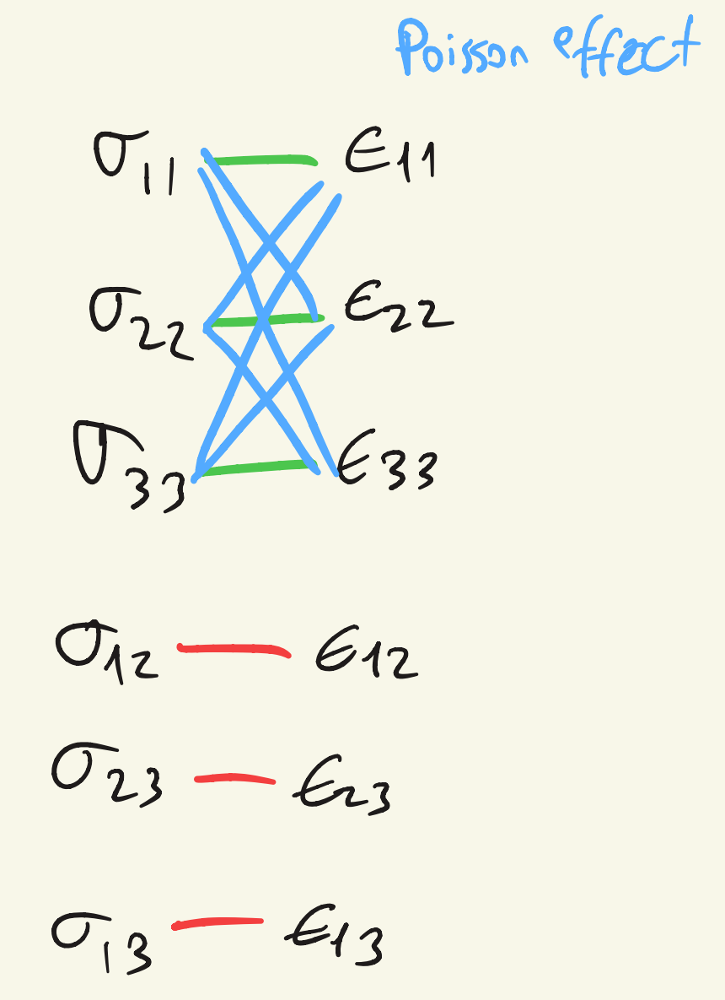

## Constitutive equations

$$
\text{Deformation} = \frac{\text{internal load}}{\text{stiffness}} = \text{compliance} \cdot \text{internal load}
$$

**Hooke's law**

$$
\epsilon = D : \sigma
\quad \Longleftrightarrow \quad
\epsilon = D\sigma
$$

| Symbol | Index form | Matrix form |
| --- | --- | --- |
| $\epsilon$ | $3 \times 3$ | $6 \times 1$ |
| $D$ (compliance matrix) | $3 \times 3 \times 3 \times 3$ | $6 \times 6$ |
| $\sigma$ | $3 \times 3$ | $6 \times 1$ |

The $:$ is the scalar product. Identify $D$, or its inverse $C$ (stiffness matrix):

$$
\sigma = C : \epsilon
$$

One dimensional: $\sigma = E\epsilon$

$C \rightarrow$ 36 independent coefficients (in general).

## Green elastic material

Relation between the stress tensor $\sigma$ and the strain energy density $U$.

$$
U = \frac{1}{2} F (l - l_0) = \frac{1}{2} k (l - l_0)^2
\qquad
F = \frac{dU}{dl}
$$

$$
U(\epsilon_{ij}) = \beta_{ijkl} \, \epsilon_{ij} \epsilon_{kl}
$$

$$
\sigma_{ij} = \beta_{ijkl} \epsilon_{kl} + \beta_{klij} \epsilon_{kl} = \left(\beta_{ijkl} + \beta_{klij}\right) \epsilon_{kl} = C_{ijkl} \epsilon_{kl}
$$

(Symmetry implied.) The number of elastic coefficients reduces to 21.

$$
U(\epsilon_{ij}) = \frac{1}{2} C_{ijkl} \epsilon_{ij} \epsilon_{kl} = \frac{1}{2} \sigma_{ij} \epsilon_{ij}
$$

- If the material has one single plane of symmetry, elastic constant count $= 13$.
- If there are 3 orthogonal planes of symmetry, orthotropic material $\rightarrow$ 9 material constants.
- Transversely isotropic (rotational symmetry) $\rightarrow$ 5 constants.
- Isotropy $\rightarrow$ 2 elastic constants $(E, \nu)$.

## Isotropic

Stiffness model:

$$
C_{ijkl} = \lambda \delta_{ij}\delta_{kl} + \mu_1 \delta_{ik}\delta_{jl} + \mu_2 \delta_{il}\delta_{jk}
$$

$$
\sigma_{ij} = \lambda \delta_{ij}\delta_{kl}\epsilon_{kl} + \mu_1 \delta_{ik}\delta_{jl}\epsilon_{kl} + \mu_2 \delta_{il}\delta_{jk}\epsilon_{kl}
$$

$\lambda$, $\mu_1$ and $\mu_2$ are scalar constants which express material properties.

$$
\sigma_{22} = \lambda(\epsilon_{11} + \epsilon_{22} + \epsilon_{33}) + (\mu_1 + \mu_2)\epsilon_{22}
\qquad
\sigma_{32} = \mu_1 \epsilon_{32} + \mu_2 \epsilon_{23}
$$

Because of symmetry: $\mu_1 = \mu_2 = \mu$

$$
\sigma_{22} \leftrightarrow \epsilon_{22}: \ \lambda + 2\mu
\qquad
\sigma_{22} \leftrightarrow \epsilon_{11}, \epsilon_{33}: \ \lambda
\qquad
\sigma_{32} \leftrightarrow \epsilon_{32}: \ 2\mu
$$

## In conclusion: linear elastic isotropic material model

$$
\sigma_{ij} = \lambda \epsilon_{kk} \delta_{ij} + 2\mu \epsilon_{ij}
$$

Lamé coefficients: $\lambda$ and $\mu$ $[\text{Pa}]$

$$
\begin{Bmatrix} \sigma_{xx} \\ \sigma_{yy} \\ \sigma_{zz} \\ \sigma_{xy} \\ \sigma_{yz} \\ \sigma_{zx} \end{Bmatrix}
= \begin{bmatrix}
\lambda + 2\mu & \lambda & \lambda & 0 & 0 & 0 \\
\lambda & \lambda + 2\mu & \lambda & 0 & 0 & 0 \\
\lambda & \lambda & \lambda + 2\mu & 0 & 0 & 0 \\
0 & 0 & 0 & 2\mu & 0 & 0 \\
0 & 0 & 0 & 0 & 2\mu & 0 \\
0 & 0 & 0 & 0 & 0 & 2\mu
\end{bmatrix}
\begin{Bmatrix} \epsilon_{xx} \\ \epsilon_{yy} \\ \epsilon_{zz} \\ \epsilon_{xy} \\ \epsilon_{yz} \\ \epsilon_{zx} \end{Bmatrix}
$$

$C$ is symmetric.

$$
\epsilon = D\sigma = C^{-1}\sigma
$$

$$
\begin{Bmatrix} \epsilon_{xx} \\ \epsilon_{yy} \\ \epsilon_{zz} \\ \epsilon_{xy} \\ \epsilon_{yz} \\ \epsilon_{zx} \end{Bmatrix}
= \frac{1}{E}
\begin{bmatrix}
1 & -\nu & -\nu & 0 & 0 & 0 \\
-\nu & 1 & -\nu & 0 & 0 & 0 \\
-\nu & -\nu & 1 & 0 & 0 & 0 \\
0 & 0 & 0 & 1 + \nu & 0 & 0 \\
0 & 0 & 0 & 0 & 1 + \nu & 0 \\
0 & 0 & 0 & 0 & 0 & 1 + \nu
\end{bmatrix}
\begin{Bmatrix} \sigma_{xx} \\ \sigma_{yy} \\ \sigma_{zz} \\ \sigma_{xy} \\ \sigma_{yz} \\ \sigma_{zx} \end{Bmatrix}
$$

Conversions between the Lamé coefficients and $E$, $\nu$:

$$
\lambda = \frac{E\nu}{(1 + \nu)(1 - 2\nu)}
\qquad
\mu = \frac{E}{2(1 + \nu)}
$$

$$
E = \frac{\mu(3\lambda + 2\mu)}{\lambda + \mu}
\qquad
\nu = \frac{\lambda}{2(\lambda + \mu)}
$$

## Rotating the constitutive matrices

Remember: $T = A^T T' A$, where $T'$ is in the rotated reference frame.

$$
\sigma' = C' : \epsilon'
\qquad
\epsilon' = D' : \sigma'
$$

or

$$
\{\sigma'\} = [C]'\{\epsilon'\}
\qquad
\{\epsilon'\} = [D]'\{\sigma'\}
$$

$$
\{\sigma\}' = [T][C][T]^{-1}\{\epsilon\}'
\qquad
[C]' = [T][C][T]^{-1}
$$

$$
\begin{Bmatrix} \epsilon_{11} \\ \epsilon_{22} \\ \gamma_{12} \end{Bmatrix}
= \begin{bmatrix}
\cos^2\theta & \sin^2\theta & \sin\theta\cos\theta \\
\sin^2\theta & \cos^2\theta & -\sin\theta\cos\theta \\
-2\sin\theta\cos\theta & 2\sin\theta\cos\theta & \cos 2\theta
\end{bmatrix}
\begin{Bmatrix} \epsilon_{xx} \\ \epsilon_{yy} \\ \gamma_{xy} \end{Bmatrix}
$$

$$
[C'] = [T_\sigma]^{-1}[C][T_\epsilon]
\qquad
[D'] = [T_\epsilon]^{-1}[D][T_\sigma]
$$

## Orthotropic compliance matrix

$$
\begin{Bmatrix} \epsilon_{xx} \\ \epsilon_{yy} \\ \epsilon_{zz} \\ \epsilon_{xy} \\ \epsilon_{yz} \\ \epsilon_{zx} \end{Bmatrix}
= \begin{bmatrix}
\frac{1}{E_x} & -\frac{\nu_{yx}}{E_y} & -\frac{\nu_{zx}}{E_z} & 0 & 0 & 0 \\
-\frac{\nu_{xy}}{E_x} & \frac{1}{E_y} & -\frac{\nu_{zy}}{E_z} & 0 & 0 & 0 \\
-\frac{\nu_{xz}}{E_x} & -\frac{\nu_{yz}}{E_y} & \frac{1}{E_z} & 0 & 0 & 0 \\
0 & 0 & 0 & \frac{1}{2\mu_{xy}} & 0 & 0 \\
0 & 0 & 0 & 0 & \frac{1}{2\mu_{yz}} & 0 \\
0 & 0 & 0 & 0 & 0 & \frac{1}{2\mu_{zx}}
\end{bmatrix}
\begin{Bmatrix} \sigma_{xx} \\ \sigma_{yy} \\ \sigma_{zz} \\ \sigma_{xy} \\ \sigma_{yz} \\ \sigma_{xz} \end{Bmatrix}
$$

From symmetry:

$$
E_x \nu_{yx} = E_y \nu_{xy}
\qquad
E_y \nu_{zy} = E_z \nu_{yz}
\qquad
E_z \nu_{xz} = E_x \nu_{zx}
$$
